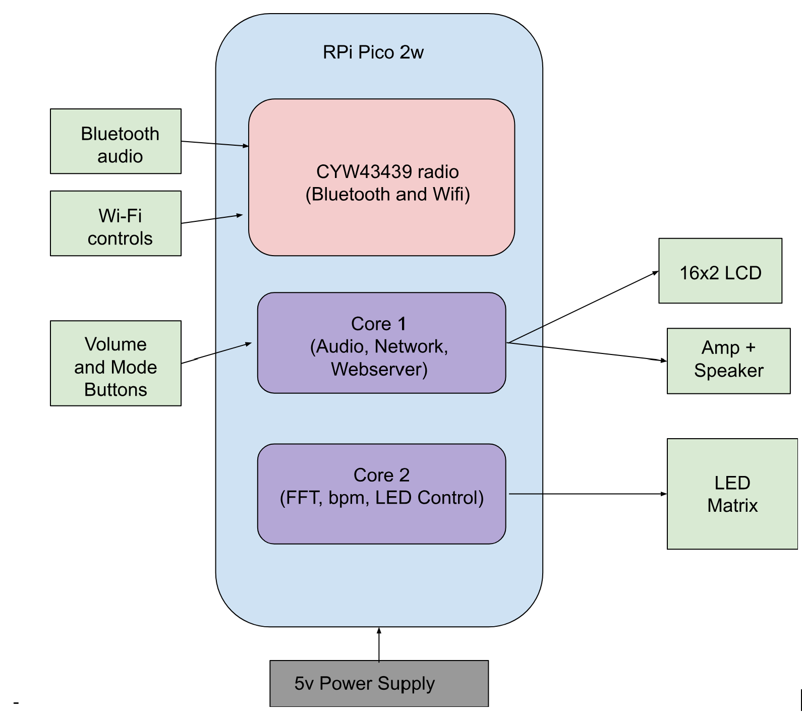

# 4607_Final_Project

## Project Goal
The goal of this project is to design and implement a sound-reactive speaker that connects to a laptop over bluetooth to play audio files, changing the behavior of an LCD matrix based on the audio file played. As a popular kind of product on the market right now, we believe that it would be very beneficial to our learning to see how this speaker works at a low level, along with learning about communication protocols, audio analysis, multiprocessing, and the manipulation of inputs and outputs to control a device.

## Components

